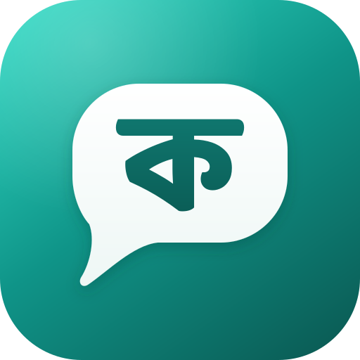

<div align="center">



# VarsityKotha · ভার্সিটি কথা

**The daily app for university students in Bangladesh:** class routine and
reminders every morning, and a safe, anonymous voice to get campus problems
fixed.

[varsitykotha.com](https://varsitykotha.com) ·
[Privacy](https://varsitykotha.com/privacy) ·
Android app ID `com.silifton.varsitykotha`

</div>

> Renamed from "Campus Saga" on 2026-10-28. Everything uses the new name: repo,
> domain, server, Firebase project, the app package (`varsitykotha`) and the
> web package. The shared `campus_*` packages, the `campusapi` binary and the
> `campus` database are plain "campus" names. Only history keeps the old name
> (old migrations), plus the live photo storage folder (`campussaga/voice/`,
> pinned with `NIMBUS_PREFIX` so existing photos keep working). The old v1
> app is kept at the git tag `v1-archive`.

## What's in it

- **My Class:** class groups with a shared routine, reminders, cancelled or
  moved classes (also to another day), tests and deadlines, announcements and
  pushes, retakes, personal classes, and a home-screen widget.
- **Find your class:** search routines other students made and join the whole
  group or just the courses you take.
- **Campus Voice:** anonymous campus issues with photos, checked by an
  on-server photo filter and a word list, and moderated from the admin panel.
- **Explore:** bus routes on an OpenStreetMap map, with the next bus from your stop, and a CGPA calculator.
- **Admin panel** at [varsitykotha.com/admin](https://varsitykotha.com/admin):
  users, universities, groups, moderation, bus routes, pushes and app settings.

English and Bangla throughout.

## Where it runs

| | |
|---|---|
| Site + admin | https://varsitykotha.com (`apps/web`, Next.js) |
| API | https://api.varsitykotha.com/api/v1 (`backend`, Go + PostgreSQL 18) |
| Server | Tecsior VPS, `/opt/varsitykotha`, compose project `varsitykotha` ([docs/DEPLOYMENT.md](docs/DEPLOYMENT.md)) |
| DNS | Cloudflare, DNS only (not proxied) |
| Firebase | project `varsitykotha`: Google sign-in, push (FCM), Crashlytics |
| Photos | Nimbus object storage |

The old addresses (`campus.silifton.com`, `api-campus.silifton.com`) still
work: the site redirects, and the API keeps serving older app builds.

## Docs

| | |
|---|---|
| [PLAN.md](PLAN.md) | Vision, users, principles, growth, risks |
| [docs/ROADMAP.md](docs/ROADMAP.md) | Releases R0–R5, scope, definition of done |
| [docs/ARCHITECTURE.md](docs/ARCHITECTURE.md) | Database, system design, data model, app structure |
| [docs/DESIGN_SYSTEM.md](docs/DESIGN_SYSTEM.md) | Colors, type, icons (Phosphor), components, rebranding checklist |
| [docs/ADMIN.md](docs/ADMIN.md) | Web and admin panel, admin API |
| [docs/CAMPUS_VOICE.md](docs/CAMPUS_VOICE.md) | Campus Voice: spec, moderation, photos |
| [docs/TESTS_AND_MOVES.md](docs/TESTS_AND_MOVES.md) | Classes moved to another day, tests and deadlines |
| [docs/BETA.md](docs/BETA.md) | Beta checklist: builds, reviewer access, phone tests |
| [docs/PLAY_STORE.md](docs/PLAY_STORE.md) | Google Play: listing assets, form answers, release steps |
| [docs/DEPLOYMENT.md](docs/DEPLOYMENT.md) | Running the API, web and Postgres on our VPS |
| [docs/UNIVERSITIES.md](docs/UNIVERSITIES.md) | All 169 Bangladeshi universities and their student email domains |
| [site/](site/) | Static copy of the public pages on GitHub Pages |

## Project layout

```
apps/mobile/            Flutter app (Android, iOS)  · com.silifton.varsitykotha
apps/web/               Next.js: public pages + superadmin panel (varsitykotha.com)
packages/campus_core/   Domain models, repository interfaces (pure Dart)
packages/campus_ui/     Design system: tokens, theme, components, brand mark
packages/campus_data/   HTTP implementations of the repositories (talks to the Go API)
packages/campus_l10n/   English + Bangla strings
backend/                Go API: cmd/campusapi, internal/ (platform, modules), migrations/
backend/nsfw/           On-server photo check (ONNX model) for Campus Voice
backend/deploy/         compose.yaml, nginx vhosts, deploy and backup scripts
assets/icon/            Master icon artwork (SVG)
tool/                   Scripts (test_all.sh)
```

It's a Dart pub workspace: one `flutter pub get` at the root resolves
everything.

## Getting started

`apps/mobile/android/app/google-services.json` is not in git. Download it
from the Firebase console (project `varsitykotha` → Android app
`com.silifton.varsitykotha`) or run `flutterfire configure` in `apps/mobile`.
CI writes it from the `GOOGLE_SERVICES_JSON` repository secret.

Requires Flutter 3.47+ (Dart 3.13+).

```bash
flutter pub get
cp apps/mobile/env/example.json apps/mobile/env/local.json
cd apps/mobile && flutter run --dart-define-from-file=env/local.json
```

## Backend (local)

Needs Go 1.26+ and Docker (OrbStack).

```bash
cd backend
make deps-up      # Postgres 18 (:55632) + Mailpit (SMTP :55625, UI http://localhost:58025)
make run          # API on http://localhost:8090/api/v1 (applies migrations first)
make seed         # dev universities: demo.ac.bd, sit.edu.bd
make test         # go test -race, fresh database per test
```

Sign in locally with any address at `demo.ac.bd`; the 6-digit code arrives
in Mailpit at http://localhost:58025 (without SMTP configured, the server
logs it). Set `API_BASE_URL` in `apps/mobile/env/local.json`: the Android
emulator reaches your Mac at `http://10.0.2.2:8090/api/v1`.

The web app: `cd apps/web && npm install && npm run dev` (see
[apps/web/README.md](apps/web/README.md)).

## Build and deploy

```bash
apps/mobile/tool/build.sh          # asks: server, APK/App Bundle, build number, phone to install on
backend/deploy/deploy.sh           # API: backup, build, migrate, restart, health check
backend/deploy/deploy-web.sh       # site + admin panel
```

## Everyday commands

```bash
dart format .                 # format
flutter analyze               # lint the whole workspace
./tool/test_all.sh            # run every test
```

Changing text: edit `packages/campus_l10n/lib/src/arb/*.arb`, then run
`flutter gen-l10n` inside `packages/campus_l10n`.

## Brand

The mark is ক (Baloo Da 2 ExtraBold, SIL Open Font License, kept as
outlines) in a speech bubble on a teal tile: *kotha* means "talk". Master
artwork is in [assets/icon/](assets/icon/). To change the launcher icons,
export new PNGs into `apps/mobile/assets/launcher/` and run
`dart run flutter_launcher_icons` in `apps/mobile`
(see `apps/mobile/flutter_launcher_icons.yaml`).
